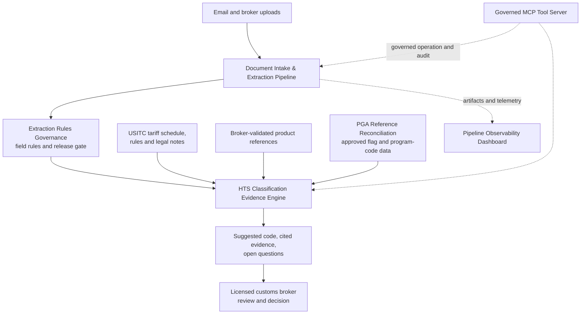

# Alembic — DATA HERMETICA AI Automation Engine and HTS Evidence Platform

Private, locally operated automation that turns trade documents into validated data and classification evidence for licensed customs brokers.

  

## System



## Overview

Entry preparation depends on data locked inside supplier documents and on classification work that must be defensible line by line. This system automates the mechanical part of both and keeps every decision with the licensed broker. Documents are received through a governed Power Automate flow and extracted by a model that runs on the operator's own hardware; results are published only after deterministic validation. Classification research is assembled from official tariff sources, constrained to cited evidence, and returned as a suggestion with its reasoning trail. Reference data and extraction rules pass through approval gates with audit records before anything downstream can use them.

Alembic is the name of the system as a whole: like the distillation vessel it is named after, it takes raw material in and returns a refined, verifiable product. The system is deployed in controlled operation on DATA HERMETICA infrastructure and is designed for installation on a broker-operated server inside the broker's environment.

## Components

| Component | Purpose | Release | In this repository |
|---|---|---|---|
| [Document Intake & Extraction Pipeline](components/document-intake-extraction-pipeline) | Power Automate intake, local-model extraction, deterministic validation | 1.2.0 | Source, tests, documentation |
| [Pipeline Observability Dashboard](components/pipeline-observability-dashboard) | Read-only, eight-stage view of every document | 1.0.0 | Specification |
| [HTS Classification Evidence Engine](components/hts-classification-evidence-engine) | Retrieval-grounded HTS research with cited evidence | 0.3.0 | Specification |
| [PGA Reference Reconciliation](components/pga-reference-reconciliation) | Exact reconciliation of PGA flag data to the tariff schedule, with approval | 1.0.0 | Specification |
| [Extraction Rules Governance](components/extraction-rules-governance) | Versioned extraction rules, generated schemas, release gate | 1.0.0 | Specification |
| [Governed MCP Tool Server](components/governed-mcp-tool-server) | Policy-governed workstation and analysis tools for AI clients | 1.0.0 | Specification |

## Design principles and controls

- **Local inference.** Models run on the operator's hardware. Document content is not sent to an external AI service.
- **Deterministic gates around every model.** Strict output schemas, closed evidence and candidate sets, and code-computed checks decide what is accepted. Model output alone never does.
- **No guessing.** Missing values stay null, ambiguous numbers are rejected, and missing decisive facts return a needs-information result.
- **Approval before use.** Reference batches and extraction configurations are inert until a broker approves them, with identity recorded.
- **Audit trails.** Requests, raw responses, normalization steps, configuration revisions and approvals are retained with hashes.
- **Read-only observation.** Monitoring reads artifacts and cannot alter processing.
- **Loopback services.** Dashboards and stores listen on the local host; remote access is through a private network.

Details: [System architecture](docs/system-architecture.md).

## Technology

Python 3.12 · Microsoft Power Automate, Office 365 Outlook, OneDrive for Business · LM Studio (OpenAI-compatible local inference) · Poppler · SQLite · Neo4j · Qdrant · Model Context Protocol · PowerShell and Windows Task Scheduler

## Repository layout

```
components/
  document-intake-extraction-pipeline/   src, config, prompts, scripts, samples, tests, docs
  pipeline-observability-dashboard/      README, docs
  hts-classification-evidence-engine/    README, docs
  pga-reference-reconciliation/          README, docs
  extraction-rules-governance/           README, docs
  governed-mcp-tool-server/              README, docs, THIRD_PARTY_NOTICES
docs/system-architecture.md
.github/workflows/ci.yml
```

## Getting started

The Document Intake & Extraction Pipeline is runnable from this repository. Prerequisites: Python 3.12 and Poppler on `PATH`.

```powershell
cd components\document-intake-extraction-pipeline
python -m pip install -e .
python -m unittest discover -s tests -v
```

Configuration, the sample document and the supervised run are described in the [component README](components/document-intake-extraction-pipeline/README.md).

## Verification

| Date | Component | Evidence | Result |
|---|---|---|---|
| 2026-11-12 | Document pipeline | Unit tests in this repository | 24 of 24 passed |
| 2026-11-11 | Document pipeline, dashboard | Documents tracked in controlled operation | 14 tracked: 13 completed, 1 routed to review |
| 2026-11-11 | PGA reconciliation | Read-only query of the evidence store | 81,740 rows: 79,551 exact matches (97.32%), 2,189 quarantined, 0 invalid |
| 2026-11-10 | HTS evidence engine | Product-reference logic | 58 of 58 rows reconciled; 43 of 43 exact lookups; 2 of 2 obsolete codes blocked |
| 2026-11-08 | HTS evidence engine | Controlled classification case | Proposal with 11 cited evidence identifiers, 0 unresolved citations, 0 reasoning tokens; routed to broker review |
| 2026-11-08 | All services | Service checks | 8 of 8 passed |

No field-level extraction accuracy rate and no classification accuracy rate is claimed. Both require labelled evaluation sets, which are on the roadmap.

## Scope and compliance

- **Deployment model.** Client-controlled infrastructure. The software is supplied for operation by or for the broker, not as a public online service.
- **Regulatory position.** Under CBP ruling HQ H350722 (2026-01-16), this system is decision-support software operated by or for a licensed customs broker. The broker determines which fields are extracted, validates product facts, makes every classification, approval and filing decision, and the software does not transmit to CBP.
- **Boundaries.** The system does not make a final HTS determination, determine PGA applicability, calculate duty, prepare entry forms for filing, or perform ABI transmission.
- **Sources of authority.** Official tariff text, notes, the General Rules of Interpretation and verified CBP rulings govern. Broker product history, printed foreign commodity codes, trade statistics and PGA flag reports are reference evidence.

## Roadmap

- Publication of the source for the five components currently documented as specifications.
- A multi-document extraction worker driven by the active extraction-rules configuration.
- Labelled evaluation sets per document type and field; adversarial classification cases.
- Ingestion of an authorized CBP CROSS corpus and a licensed WCO corpus.
- Cross-document reconciliation across invoice, packing list, bill of lading and safety data sheet.
- Versioned deployment package with a clean-host restoration test.

## License

Copyright © 2026 DATA HERMETICA. All rights reserved. Proprietary — see [LICENSE](LICENSE).
