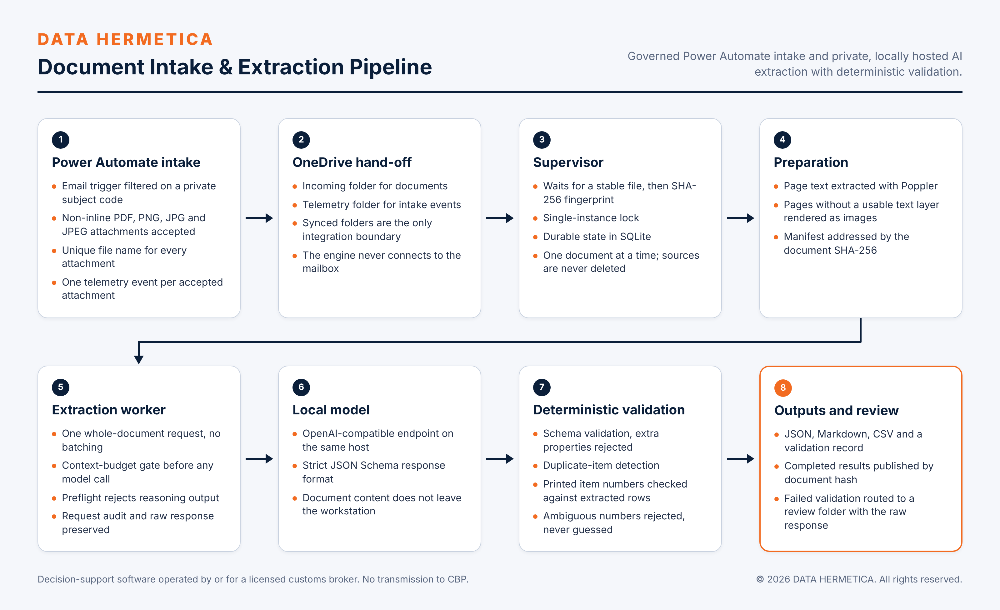

# DATA HERMETICA Document Intake & Extraction Pipeline

Turns emailed and uploaded business documents into validated, structured line-item data using governed Power Automate intake and private, locally hosted AI.

 



## Overview

Commercial invoices arrive by email in supplier-specific layouts, and re-keying their line items into entry-preparation systems is slow and error-prone. This pipeline receives the attachment through a governed Power Automate flow, extracts every invoice and merchandise line with a vision-language model hosted on the operator's own workstation, and accepts the result only after deterministic validation. Each accepted document yields JSON, Markdown and a 13-column CSV, addressed by the SHA-256 of the source file. Documents that fail validation are routed to a review folder with the raw model response, so no unverified result is published as complete.

Status: reference implementation, deployed and supervised in controlled operation on DATA HERMETICA infrastructure.

## Capabilities

- **Governed intake.** A Power Automate flow accepts non-inline PDF, PNG, JPG and JPEG attachments, saves each under a unique name, and writes one telemetry event per attachment. See [Power Automate intake and telemetry](docs/power-automate-intake.md).
- **Supervised processing.** A supervisor waits until a synced file is stable, fingerprints it with SHA-256, holds a single-instance lock, and processes one document at a time. It never deletes a source file.
- **Document preparation.** Poppler extracts page text. A page with fewer than 80 alphanumeric characters is rendered at 180 DPI and sent to the model as an image.
- **Whole-document extraction.** One request per document to an OpenAI-compatible local endpoint, with a strict JSON Schema response format. The worker never splits a document into batches.
- **Deterministic validation.** Schema validation that rejects extra properties, duplicate-item detection, a completeness check of printed item numbers against extracted rows, and unit-price canonicalization.
- **Auditable outputs.** The request audit (page images replaced by their hashes), the raw response, the runtime preflight, the unit-price normalization record and the validation record are retained for every document.
- **Migration utility.** Upgrades results from the previous output format to the current one without a model call, and refuses to overwrite its source.

## Design principles and controls

| Control | Enforcement |
|---|---|
| No guessing | A missing value stays `null`. A comma-grouped value such as `1,234` is rejected as ambiguous; it is never interpreted. |
| Model output is untrusted | Output is parsed, validated against the schema, and checked against the source text before publication. |
| Reasoning disabled and verified | Before each extraction a preflight request must return final structured content with zero reasoning tokens. Otherwise the document is not submitted. |
| Context budget gate | Estimated input (characters ÷ 3, plus 4,096 per image) plus maximum output plus a safety margin must fit the configured context length. If it does not, the run stops; nothing is truncated or batched. |
| Fail closed | The worker refuses to run when batching is enabled or the reasoning check is disabled in configuration, and when the engine root is not configured. |
| Idempotence | A document already completed is not reprocessed unless the operator passes `--force`. |
| Source preservation | Source files are read, never moved or deleted. |

Design decisions are recorded in [docs/decisions](docs/decisions).

## Technology

- Python 3.12, standard library only
- Poppler (`pdfinfo`, `pdftotext`, `pdftoppm`)
- LM Studio, or any OpenAI-compatible local inference server with JSON Schema structured output
- SQLite in WAL mode for job and supervisor state
- Microsoft Power Automate, Office 365 Outlook and OneDrive for Business for intake
- Windows Task Scheduler for supervision

Reference model configuration: Qwen 3.8 27B (Q6_K) served by LM Studio on a 32 GB GPU; 112,896-token context; 32,768 maximum output tokens; temperature 0.7, top_p 0.8, top_k 20, presence penalty 1.5; reasoning disabled.

## Repository layout

```
src/document_pipeline/   prepare.py, worker.py, supervisor.py, upgrade_output.py
config/                  extraction_schema.json, *.example.json
prompts/                 extraction_system_prompt.txt
scripts/                 Register-SupervisorTask.ps1, Test-EngineEnvironment.ps1
samples/                 fictional invoice, expected outputs, telemetry event
tests/                   unit tests; no model or service required
docs/                    architecture, operations, security, intake flow, decisions
```

## Getting started

Prerequisites: Python 3.12 and Poppler on `PATH`. A model call additionally needs a running OpenAI-compatible local server with the configured model loaded.

```powershell
python -m pip install -e .
Copy-Item config\engine_config.example.json config\engine_config.json
Copy-Item config\supervisor_config.example.json config\supervisor_config.json
$env:DATA_HERMETICA_INVOICE_ENGINE_ROOT = (Get-Location).Path
```

Prepare the fictional sample and assemble the request without calling a model:

```powershell
python src\document_pipeline\prepare.py --file samples\SAMPLE_Supplier_Invoice_100245.pdf
python src\document_pipeline\worker.py --dry-run
```

Run the extraction, or one supervised scan of the intake folder:

```powershell
python src\document_pipeline\worker.py
python src\document_pipeline\supervisor.py --once --intake <INTAKE_FOLDER>
```

| Variable | Required | Purpose |
|---|---|---|
| `DATA_HERMETICA_INVOICE_ENGINE_ROOT` | yes | Directory holding `config/`, `prompts/` and the runtime folders `state/`, `work/`, `logs/`. |
| `OneDriveCommercial` | no | Set by the OneDrive for Business client. Default intake is `InvoiceIntake/Incoming` below it; results are published to `InvoiceResults/` below it. |
| `LM_STUDIO_API_TOKEN` | no | Bearer token sent to the model endpoint when set. |

Installation as a scheduled task, health checks and recovery are in [docs/operations.md](docs/operations.md). The expected result for the sample is in [samples/expected](samples/expected).

## Verification

```powershell
ruff check .
ruff format --check .
python -m unittest discover -s tests -v
```

| Date | Evidence | Result |
|---|---|---|
| 2026-11-12 | Unit tests in this repository (no model, no services) | 24 of 24 passed |
| 2026-11-12 | Preparation and dry run on the fictional sample; item-number detection on its text layer | 1 page, 3 of 3 printed items detected |
| 2026-11-11 | Documents tracked in controlled operation | 14 tracked: 13 completed, 1 routed to review |
| 2026-11-10 to 2026-11-12 | Email-to-saved-file intake latency over 3 runs | 19.0 s, 23.8 s, 19.2 s |
| Historical | Multi-page commercial invoices of 62, 31 and 3 line items | Accepted with zero validation issues |

Passing validation shows that a result is structurally complete and consistent with the checks above. It is not a measurement of field-level accuracy; that requires comparison against labelled source documents.

## Scope and compliance

- **Deployment model.** The pipeline runs on client-controlled infrastructure. Inference is local; Power Automate moves files and does not send document content to an AI service.
- **Boundaries.** The pipeline extracts and validates document data. It does not classify goods, determine Partner Government Agency requirements, prepare entry forms, or file with U.S. Customs and Border Protection. It is not a broker-production entry workflow.
- **Regulatory position.** Under CBP ruling HQ H350722 (2026-01-16), this system is decision-support software operated by or for a licensed customs broker. The broker makes every classification, approval and filing decision, and the software does not transmit to CBP.

## Roadmap

- Extraction driven by broker-approved field rules for commercial invoices, packing lists, bills of lading and safety data sheets.
- Field-level accuracy measurement against labelled document sets.
- Cross-document reconciliation of quantities, weights, parties and identifiers.

## License

Copyright © 2026 DATA HERMETICA. All rights reserved. Proprietary — see [LICENSE](LICENSE).
