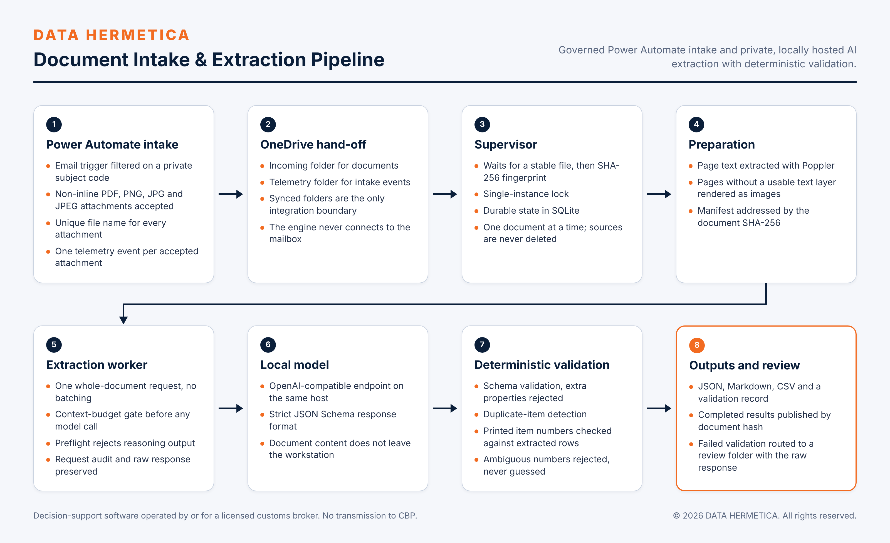
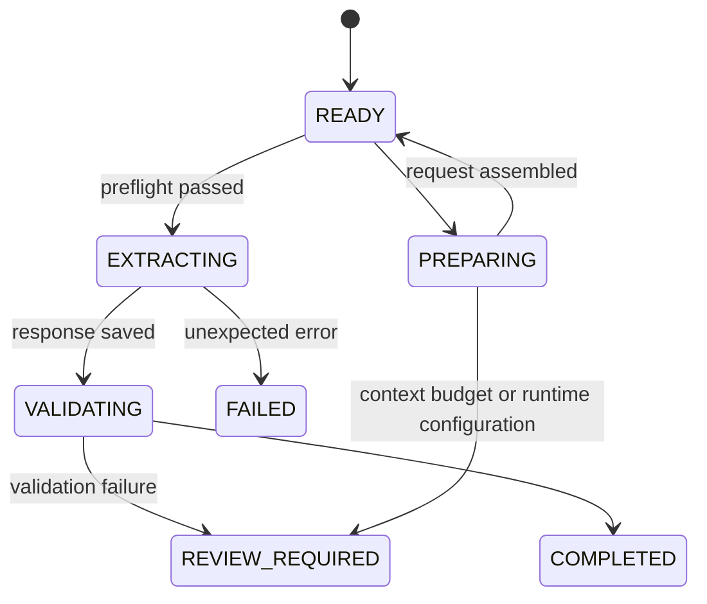

# Architecture

## Components

| Component | Module | Responsibility |
|---|---|---|
| Intake flow | Power Automate (see [power-automate-intake.md](power-automate-intake.md)) | Accept attachments, save them under unique names, emit telemetry. |
| Supervisor | `supervisor.py` | Detect stable files, fingerprint, deduplicate, run preparation and the worker as child processes, record state. |
| Preparation | `prepare.py` | Extract page text, render image pages, write the manifest. |
| Worker | `worker.py` | Assemble the request, gate the context budget, run the preflight, call the model, validate, write and publish outputs. |
| Migration | `upgrade_output.py` | Re-normalize and re-validate an existing result without a model call. |

## Data flow

1. The flow writes an attachment to `/InvoiceIntake/Incoming` and a telemetry event to `/InvoiceIntake/Telemetry` in OneDrive for Business. The OneDrive client syncs both to the workstation.
2. The supervisor lists supported files in the intake folder, oldest first. If the configured model is not listed by the endpoint, the scan is deferred and files stay pending.
3. For each file not already in a terminal state, the supervisor waits for size and modification time to hold across consecutive checks, hashes the bytes, and confirms the file did not change during hashing.
4. Preparation writes `work/prepared/<sha256>/` containing one text file per page, a PNG for each page with fewer than 80 alphanumeric characters, and `manifest.json` (schema version 2). Output is staged in a temporary directory and copied into place only when complete.
5. The worker builds one request: system prompt, a fixed user instruction, then each page as delimited text followed by its image when present. It writes the request audit to `work/requests/`, with images replaced by file hash and size.
6. The worker verifies the model is listed, runs the preflight, and sends the request. The raw response is written to `work/responses/` before any parsing.
7. Validation runs in this order: final content present, not truncated by the output limit, valid JSON object, unit-price normalization, schema validation, business validation.
8. On success, outputs are written to `work/output_staging/<sha256>/` and copied to `InvoiceResults/Completed/<sha256>/`. On a validation failure, the raw response and the error text are copied to `InvoiceResults/ReviewRequired/<sha256>/`.

## State

`state/jobs.db` (worker) holds one row per document hash.

`state/supervisor.db` holds `supervisor_documents` (one row per document hash, with attempt count and last error) and `source_observations` (one row per source path, with size and modification time). A path whose size and modification time are unchanged and whose status is terminal is skipped without re-hashing.

Both databases use WAL journaling. A document in `REVIEW_REQUIRED` or `FAILED` is never retried automatically.

## Output contract

| File | Content |
|---|---|
| `extraction.json` | Full result conforming to `config/extraction_schema.json`. |
| `extraction.md` | Invoice details table and one merchandise table per invoice. |
| `<invoice number>.csv` | One file per invoice; 13 columns; UTF-8 with BOM; `null` for absent values. |
| `unit-price-normalization.json` | Before and after values for every merchandise line. |
| `validation.json` | Status, counts and the printed item numbers found in the source text. |

CSV columns: Item, Product Number, Material Description, Unit, Quantity, Unit Price (USD), Total Amount (USD), Country of Origin, Delivery Note, Gross Weight, Net Weight, Commodity Code, Shipment Number.

## Trust boundaries

| Boundary | Crossing | Control |
|---|---|---|
| Internet to mailbox | Email with attachments | Subject-code filter and attachment condition in the flow. |
| Cloud to workstation | OneDrive sync | Files are treated as data; stability and hash checks before use. |
| Document to model | Page text and images | The prompt treats instructions inside a document as source content. The response is constrained by a strict schema. |
| Model to outputs | JSON text | Deterministic validation; failures are quarantined for review. |
