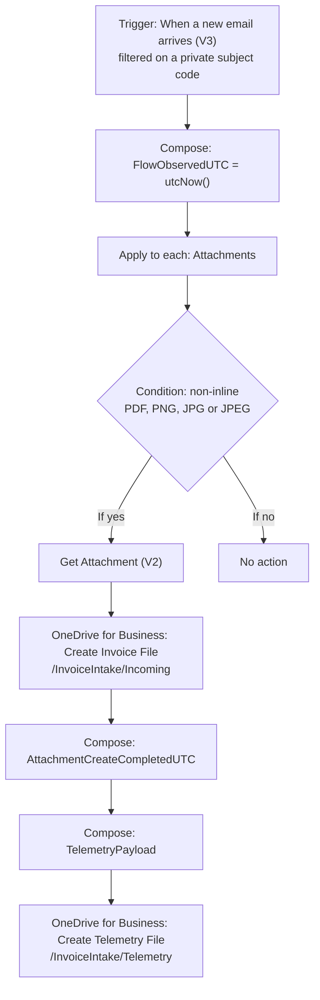

# Power Automate intake and telemetry

The intake flow, "Email - Customs Invoice Extraction", is the entry point of the pipeline. It accepts document attachments from a monitored mailbox, saves each accepted attachment to OneDrive for Business under a unique name, and writes one telemetry event per accepted attachment. The extraction engine never connects to the mailbox. The OneDrive folders are the integration boundary between Power Automate and the locally hosted engine.

The flow is documented here as a definition. An exported flow package is not part of this repository, because a package carries connection references and environment identifiers that are specific to one deployment.

## Flow structure



## Steps

1. **Trigger: When a new email arrives (V3).** The trigger is filtered on a private subject code, so only email that carries the code starts a run.
2. **Compose `FlowObservedUTC`.** The action evaluates `utcNow()` and records the moment the run starts processing the email.
3. **Apply to each** over the trigger's `Attachments` collection.
4. **Condition.** The flow accepts an attachment only when it is not inline and its name ends in `.pdf`, `.png`, `.jpg` or `.jpeg`. The comparison is case-insensitive, and a missing name is treated as an empty string.
5. **If yes:**
   1. **Get Attachment (V2)** retrieves the attachment content.
   2. **Create Invoice File** (OneDrive for Business) writes the content to `/InvoiceIntake/Incoming`. The file name is `concat(guid(),'_',item()?['Name'])`, so two attachments with the same original name never collide.
   3. **Compose `AttachmentCreateCompletedUTC`** records the time after the file has been created.
   4. **Compose `TelemetryPayload`** builds the telemetry event.
   5. **Create Telemetry File** (OneDrive for Business) writes the event to `/InvoiceIntake/Telemetry`. The file name is `concat(workflow().run.name,'_',guid(),'.json')`.
6. **If no:** the flow takes no action for that attachment.

### Attachment condition

```
and(not(equals(item()?['IsInline'], true)),
    or(endsWith(toLower(coalesce(item()?['Name'], '')), '.pdf'),
       endsWith(toLower(coalesce(item()?['Name'], '')), '.png'),
       endsWith(toLower(coalesce(item()?['Name'], '')), '.jpg'),
       endsWith(toLower(coalesce(item()?['Name'], '')), '.jpeg')))
```

### TelemetryPayload expression

The expression is deployed as a single line. It is shown indented here for readability.

```
addProperty(addProperty(addProperty(addProperty(addProperty(
addProperty(addProperty(addProperty(addProperty(addProperty(
  json('{}'),
  'schema_version', 1),
  'event_type', 'attachment_created'),
  'file_name', body('Create_Invoice_File')?['Name']),
  'email_message_id', coalesce(triggerBody()?['Id'], triggerBody()?['id'])),
  'email_received_utc', coalesce(triggerBody()?['DateTimeReceived'], triggerBody()?['receivedDateTime'])),
  'flow_run_id', workflow().run.name),
  'flow_observed_utc', outputs('FlowObservedUTC')),
  'attachment_create_completed_utc', outputs('AttachmentCreateCompletedUTC')),
  'email_subject', coalesce(triggerBody()?['subject'], triggerBody()?['Subject'], '')),
  'email_body_html', coalesce(triggerBody()?['body'], triggerBody()?['Body'], ''))
```

## Telemetry contract

The flow writes one JSON event per accepted attachment. The contract is `schema_version` 1 with `event_type` `attachment_created`.

| Field | JSON type | Source in the flow | Meaning |
|---|---|---|---|
| `schema_version` | number | constant `1` | Version of this contract. |
| `event_type` | string | constant `attachment_created` | Event discriminator. |
| `file_name` | string | `body('Create_Invoice_File')?['Name']` | Name of the file created in `/InvoiceIntake/Incoming`, including the GUID prefix. This value joins the event to the document the engine processes. |
| `email_message_id` | string | `triggerBody()?['Id']` | Message identifier supplied by the email trigger. |
| `email_received_utc` | string (timestamp) | `triggerBody()?['DateTimeReceived']` | Time the mailbox received the email. |
| `flow_run_id` | string | `workflow().run.name` | Identifier of the flow run. |
| `flow_observed_utc` | string (timestamp) | `outputs('FlowObservedUTC')` | Time the run started processing the email. |
| `attachment_create_completed_utc` | string (timestamp) | `outputs('AttachmentCreateCompletedUTC')` | Time recorded after the attachment file was created. |
| `email_subject` | string | `triggerBody()?['subject']` | Subject of the email; an empty string when absent. |
| `email_body_html` | string | `triggerBody()?['body']` | Raw HTML body of the email; an empty string when absent. |

The environment's data loss prevention (DLP) policy blocks the HTML-to-text connector. The flow therefore stores the raw HTML, and the Pipeline Observability Dashboard converts it to text locally and never renders it as HTML.

### Sample event

The sample is sanitized. It is also available as [`samples/telemetry_event.sample.json`](../samples/telemetry_event.sample.json).

```json
{
  "schema_version": 1,
  "event_type": "attachment_created",
  "file_name": "3f2a9c1e-5b7d-4e80-a6c4-1d9e2f7b8a05_SAMPLE_Supplier_Invoice_100245.PDF",
  "email_message_id": "AAMkAG...[REDACTED]...AAA=",
  "email_received_utc": "2026-11-10T07:28:15+00:00",
  "flow_run_id": "08584073111739257975155343702CU18",
  "flow_observed_utc": "2026-11-10T07:28:32.1712630Z",
  "attachment_create_completed_utc": "2026-11-10T07:28:34.2185891Z",
  "email_subject": "[INTAKE-CODE]",
  "email_body_html": "<html><body><div dir=\"ltr\">[email body redacted]</div></body></html>"
}
```

## Intake latency

The three timestamps in each event give two intervals: from email receipt to the start of flow processing (`email_received_utc` to `flow_observed_utc`), and from the start of flow processing to the saved file (`flow_observed_utc` to `attachment_create_completed_utc`).

Observed over 3 runs between 2026-11-10 and 2026-11-12:

| Interval | Observed |
|---|---|
| Email received to saved file, per run | 19.0 s, 23.8 s, 19.2 s |
| Email received to flow processing, range | 17.2 s to 19.5 s |
| Flow processing to saved file, range | 1.8 s to 4.4 s |

## How the telemetry is used

The telemetry files are the link between this repository and the [Pipeline Observability Dashboard](../../pipeline-observability-dashboard). The dashboard reads the events read-only, matches each event to a document through `file_name`, and uses the timestamps to populate the "Outlook + flow" stage for that document.

## Deployment-specific configuration

The following values belong to a deployment and are not part of this repository:

- the subject code the trigger filters on, shown here as `[INTAKE-CODE]`;
- the mailbox and OneDrive for Business connections, and the identity they run under;
- the Power Platform environment that hosts the flow.

The folder paths `/InvoiceIntake/Incoming` and `/InvoiceIntake/Telemetry` are relative to the OneDrive for Business account of the connection. The extraction engine reads the locally synced copies of these folders.
