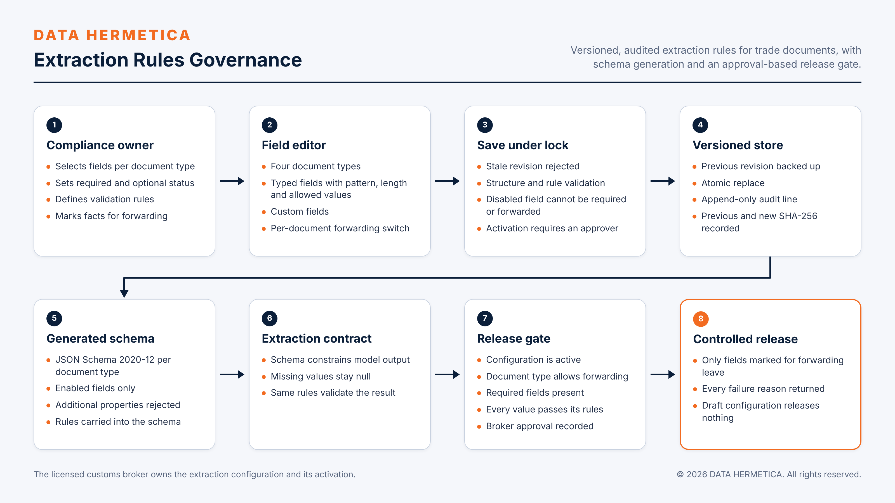

# DATA HERMETICA Extraction Rules Governance

Lets compliance owners control what is extracted from trade documents, with versioned, audited rules and an approval-based release gate.

 

## Overview

Which fields are extracted from a trade document, which are mandatory, and which may be passed on as classification facts are compliance decisions, not engineering defaults. This service puts those decisions in the hands of the compliance owner as a versioned configuration with a full change history. It generates the JSON Schema that constrains extraction from the same rules, and it enforces a release gate so that no extracted fact moves downstream from a draft configuration or without recorded broker approval.

Status: the configuration service and release gate are deployed.

## Capabilities

- **Defaults.** 4 document types and 55 fields: Commercial Invoice 19, Packing List 11, Bill of Lading 15, Safety Data Sheet 10.
- **Field properties.** Identifier, label, group (header or line), data type (string, number, integer, boolean, date); enabled, required, forward-to-HTS, custom; validation by pattern, minimum length, maximum length and allowed values. Each document type has its own forwarding switch.
- **Save, `PUT /api/config`, under a lock:** stale-revision rejection; validation (all 4 types present, identifier pattern `^[a-z][a-z0-9_]{0,63}$`, compilable patterns, length logic); rule checks (a disabled field cannot be required or forwarded; `ACTIVE` requires an approver name); backup of the previous revision; atomic replace; one append-only audit line.
- **Generated schema, `GET /api/schema/<type>`:** JSON Schema 2020-12 from the enabled fields, with `additionalProperties: false`, nullable types, and required, pattern, length and enumeration constraints carried over.
- **Release gate, `POST /api/handoff-check`.** All five conditions must hold: the configuration is `ACTIVE`; the document type allows forwarding; required fields are present; every value passes its rules; broker approval is recorded. Only fields marked for forwarding are released, and every failure reason is returned.
- **Other endpoints:** `GET /api/health`, `GET /api/config`.

## Design principles and controls

| Control | Enforcement |
|---|---|
| Configuration is a versioned artifact | Every save creates a revision and preserves the previous one. |
| Hash-chained audit | Each audit line records actor, note, revision, the previous SHA-256 and the new SHA-256. |
| Optimistic concurrency | A save based on a stale revision is rejected. |
| One source of rules | The extraction schema is generated from the configuration, so extraction and validation cannot diverge. |
| Gate separate from extraction | Release is decided by the gate, whatever produced the values. |
| Draft releases nothing | A `DRAFT` configuration blocks every hand-off. |

## Technology

Python 3.12 standard library HTTP service, JSON Schema 2020-12, a single-page HTML and JavaScript editor.

| Configuration | Purpose |
|---|---|
| `EXTRACTION_RULES_HOME` | Directory for the configuration, revision backups and audit log; default `./var` |

## Source availability

Specification of a deployed component. Its source is maintained in the controlled deployment and is not part of this revision of the repository; see the roadmap in the [system README](../../README.md).

## Verification

The service checks in the controlled suite of 2026-11-08 passed for this component. The behaviours under test are: every generated schema matches the enabled and required fields; a custom field with a pattern and lengths validates; a disabled field cannot be required or forwarded; a `DRAFT` configuration blocks every hand-off; `ACTIVE` is refused without an approver.

## Scope and compliance

The service runs on client-controlled infrastructure and listens on loopback. It governs what may be extracted and released. It does not extract, classify or file. Activation of a configuration is an act of the licensed broker or an authorized broker administrator, recorded with identity.

## Roadmap

- Publication of the service source and tests in this repository, including stale-revision and audit-chain tests.
- A multi-document extraction worker that applies the active configuration to all four document types.
- Review screens for extracted fields with field-level evidence and corrections.

## License

Copyright © 2026 DATA HERMETICA. All rights reserved. Proprietary — see [LICENSE](LICENSE).
