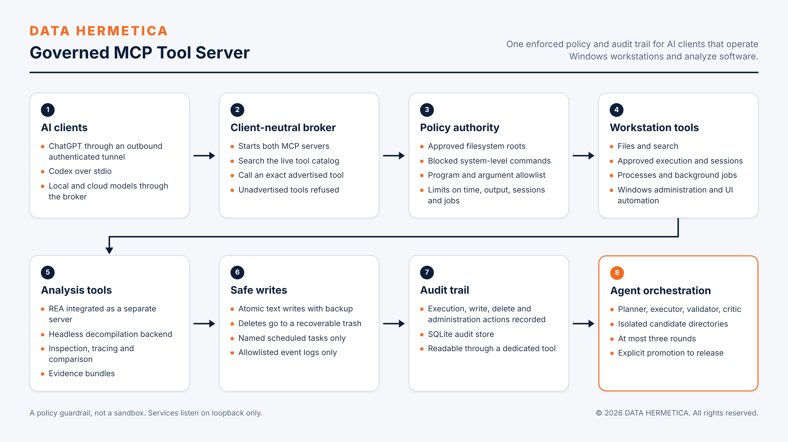

# DATA HERMETICA Governed MCP Tool Server

A policy-governed Model Context Protocol layer that lets ChatGPT, Codex, local models and cloud model APIs operate Windows workstations, and analyze software through REA, under one enforced rule set with an audit trail.

 

## Overview

Giving an AI client the ability to act on a workstation is useful only if the limits of that ability are set in one place and hold for every client. This server is that place. It exposes 36 workstation tools over the Model Context Protocol, integrates 229 software-analysis tools from REA as a separate server, and applies a single policy to all of them: where files may be touched, which programs and commands may run, how long and how much. Clients cannot widen the policy. Consequential actions are written to an audit store.

Status: deployed in controlled operation.

## Capabilities

36 workstation tools:

| Group | Count | Tools |
|---|---|---|
| Status, policy, audit | 3 | `server_status`, `policy_status`, `read_audit_log` |
| Files | 7 | `list_directory`, `read_text`, `write_text`, `replace_text`, `move_path`, `delete_path`, `search_text` |
| Approved execution | 4 | `run_approved_program`, `run_python_file`, `run_approved_powershell`, `run_shell_command` |
| Interactive sessions | 5 | `start_shell_session`, `start_terminal_session`, `send_terminal_input`, `read_terminal_session`, `stop_terminal_session` |
| Processes and jobs | 5 | `list_processes`, `terminate_process`, `start_background_job`, `get_background_job`, `cancel_background_job` |
| Windows administration | 3 | `list_scheduled_tasks`, `run_approved_scheduled_task`, `read_windows_event_log` |
| Desktop UI automation | 9 | `list_windows`, `inspect_window`, `invoke_element`, `screenshot`, `click_at`, `scroll_at`, `drag_to`, `type_text`, `press_keys` |

229 analysis tools through REA 6.8.0 on a Ghidra 12.1 headless backend (JDK 21): inspection (64), listing (21), comparison (11), tracing (10), procedures (7), capture (6), plus annotation, navigation, decompilation, instrumentation, evidence bundles and reconstruction. 24 are Android ADB tools.

Clients and orchestration:

- **ChatGPT** through the OpenAI Secure MCP Tunnel: outbound, authenticated, no inbound ports.
- **Codex** with both servers registered over stdio.
- **Broker** for any OpenAI-compatible model: starts both servers and exposes two functions, search the live catalog and call an exact advertised tool.
- **Controller:** planner, executor, deterministic validator (non-empty, JSON parse, `py_compile`), critic; a separate endpoint and model per role; at most 3 rounds; SQLite run log.

## Design principles and controls

| Control | Enforcement |
|---|---|
| Server is the authority boundary | Policy is loaded and enforced by the server. No client request can widen it. |
| Approved roots | File tools operate only below configured roots. Narrow roots are recommended. |
| Blocked commands | 33 system-level commands are refused: disk, account, boot, firewall, registry and service control. |
| Program allowlist | Python, the REA Node.js runtime and Git, each with argument validation. |
| Administration allowlists | 6 named scheduled tasks; 2 event logs (Application, System). |
| Limits | 300 s per command; 1,000,000 bytes of output; 8 sessions; 16 background jobs. |
| Recoverable writes | `write_text` is atomic and keeps a backup. Deletes go to a recoverable trash. |
| Exact tool calls | The broker refuses any tool that is not in the advertised catalog. |
| Candidate-only agent output | Agents write to isolated candidate directories behind a path-escape guard. Release requires an explicit `--promote`. |
| Credential storage | The tunnel key is stored as a DPAPI-protected secure string bound to the Windows account. |

**Audit coverage.** Execution, file-write, delete and administration actions are recorded in SQLite. `replace_text`, `move_path` and the desktop UI actions are not recorded.

**Limits of the design.** The blocked-command list and the allowlists are a policy guardrail, not a sandbox. Allowed programs run with the privileges of the server account. Isolation, where required, must come from the operating system or a virtual machine.

## Technology

Python 3.12, MCP Python SDK, PowerShell, SQLite, Windows UI Automation, REA (`rea-agents`), Ghidra, OpenAI tunnel client. Third-party components are listed in [THIRD_PARTY_NOTICES.md](THIRD_PARTY_NOTICES.md).

## Operations

Services start at logon as scheduled tasks. A hidden one-minute watchdog restores the tunnel. The Control Center dashboard reports tunnel, model, REA, agent-run and service health and provides scoped service controls: a stop action verifies the command line of a listener before ending it. Services listen on loopback only; remote access is through a private network.

## Source availability

Specification of a deployed component. Its source is maintained in the controlled deployment and is not part of this revision of the repository; see the roadmap in the [system README](../../README.md).

## Verification

The tool inventory is taken from the deployed servers: 36 tools from the `@mcp.tool` registrations of the workstation server and 229 from the REA server's tool listing. The service checks of 2026-11-08 passed for the Control Center.

## Scope and compliance

The server runs on client-controlled workstations. It is an operations and analysis tool. It takes no part in classification, approval or filing decisions. Software analysis through REA is for software the operator is authorized to analyze.

## Roadmap

- Publication of the server, broker, controller and Control Center source with an example policy that uses narrow roots.
- Audit coverage for `replace_text`, `move_path` and UI actions.
- Multi-day soak test of autostart, tunnel recovery and service restart.

## License

Copyright © 2026 DATA HERMETICA. All rights reserved. Proprietary — see [LICENSE](LICENSE).
