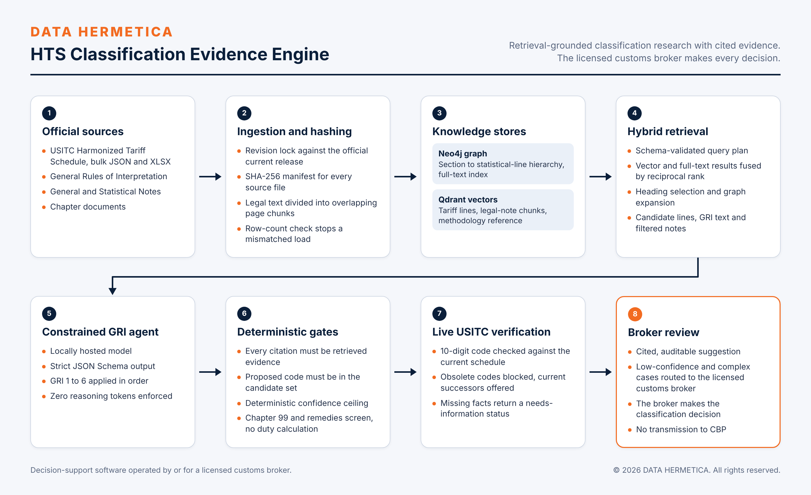

# DATA HERMETICA HTS Classification Evidence Engine

Retrieval-grounded HTS classification research that produces cited, auditable suggestions for licensed customs brokers.

 

## Overview

Classifying a product under the Harmonized Tariff Schedule of the United States requires reading the product facts against tariff text, legal notes and the General Rules of Interpretation, and recording why alternatives were rejected. The engine assembles that evidence from official sources, has a locally hosted model apply the rules in order over a bounded candidate set, and rejects any result that cites evidence it was not given or selects a code outside the candidates. The output is a suggestion with citations, eliminated alternatives, open questions and mandatory review reasons. The broker decides.

Status: version 0.3.0, deployed in controlled operation.

## Capabilities

- **Official data, revision-locked.** USITC 2026 HTS Revision 22 in bulk JSON and XLSX (35,805 rows), checked against the official current-release endpoint, with SHA-256 manifests. General Rules, General and Statistical Notes and chapter documents are downloaded, hashed and chunked by page (2,800 characters, 400 overlap).
- **Graph.** Neo4j holds 35,805 nodes in a Section, Chapter, Heading, Subheading, statistical-line hierarchy built from USITC indentation, with a full-text index. A count check stops a mismatched load.
- **Vectors.** Qdrant with `BAAI/bge-small-en-v1.5` (384 dimensions): 19,925 tariff terminal lines for Chapters 1 to 97, 6,302 legal-note chunks, and 161 methodology chunks labelled as methodology, not legal authority.
- **Constrained agent.** Strict JSON Schema output, GRI 1 to 6 applied in order, zero reasoning tokens enforced, live USITC verification of the proposed 10-digit code.
- **Chapter 99 and remedies screen.** Runs only after a Chapter 1 to 97 proposal, requires origin and entry date, and never calculates duty.
- **Broker-validated product references.** Exact part-number match takes precedence; a current-revision gate blocks obsolete codes and offers their current successors; conflicting product families block family inference.
- **Batch mode** for 1 to 50 products with a broker-review CSV export, and multimodal product-fact intake from PDF, image, CSV and XLSX.
- **Trade context.** Census International Trade API data by 10-digit code and month, for context only.

## Retrieval pipeline

1. The model plans 3 to 8 retrieval queries; the plan is schema-validated.
2. Vector and full-text results are combined by reciprocal rank fusion (k = 60); the top 200 are kept.
3. The 12 best headings are kept, each scored by the sum of its top 5 lines.
4. A second search runs inside each heading (reciprocal rank fusion, k = 30).
5. The graph expands the branch of each heading.
6. Rank-balanced quotas select 50 terminal lines.
7. The GRI text and the notes filtered to the relevant chapters and sections are always included.

## Design principles and controls

| Control | Enforcement |
|---|---|
| Similarity is discovery, not proof | Vector score never contributes to legal support or confidence. |
| Closed evidence set | A result citing evidence that was not retrieved is rejected. |
| Closed candidate set | A code outside the retrieved candidates is rejected. |
| Deterministic confidence ceiling | Computed by code from the evidence present, not asserted by the model. |
| Mandatory broker routing | Below 0.82, or when decisive facts, notes or precedent are missing, or when Chapter 99 is complex, the case routes to `LICENSED_CUSTOMS_BROKER`. |
| Fact grounding | Classification-sensitive assertions absent from the supplied facts are rejected. Unsupported facts return `NEEDS_INFORMATION` with no selected code. |
| Source boundaries | Broker precedent, printed foreign commodity codes, trade statistics and PGA flags are reference evidence, never legal authority. Licensed material is never scraped. |

## Technology

Python 3.12, Neo4j 5.26, Qdrant 1.15.5, fastembed, an OpenAI-compatible local inference server, Docker Compose for the two stores, USITC and Census public APIs.

## Source availability

Specification of a deployed component. Its source is maintained in the controlled deployment and is not part of this revision of the repository; see the roadmap in the [system README](../../README.md).

## Verification

| Date | Evidence | Result |
|---|---|---|
| 2026-11-10 | Product-reference logic | 58 of 58 invoice-to-reference rows reconciled; 43 of 43 exact part-number lookups; 2 of 2 obsolete codes blocked; family-conflict and unsupported-fact guards passed |
| 2026-11-08 | Controlled case, magnesium acetate tetrahydrate | Proposed 2915.29.50.00, status PROPOSED, review required; 0 reasoning tokens; 11 cited evidence identifiers; 0 unresolved citations |
| 2026-11-08 | Service checks | 8 of 8 services passed; single listener per dashboard confirmed |
| Earlier run | End-to-end timing for one case | 161 s; 55,798 input tokens |

**Completion gate.** The engine's own readiness audit reports not-ready until an authorized CBP CROSS rulings corpus and a licensed WCO corpus are supplied. Both collections are empty by design until then: 0 CROSS vectors, 0 WCO vectors. No accuracy rate is claimed.

## Scope and compliance

- **Deployment model.** Client-controlled infrastructure; stores and model are local.
- **Boundaries.** The engine returns suggestions for review. It does not make a final classification, calculate duty, or file.
- **Regulatory position.** Under CBP ruling HQ H350722 (2026-01-16), this system is decision-support software operated by or for a licensed customs broker. The broker makes every classification, approval and filing decision, and the software does not transmit to CBP.

## Roadmap

- Publication of the engine source, tests, compliance matrix and methodology reference in this repository.
- Ingestion of an authorized CROSS corpus and a licensed WCO corpus.
- Adversarial case set: pure compound versus prepared reagent, incomplete composition, conflicting product family, obsolete code, Chapter 99 ambiguity.

## License

Copyright © 2026 DATA HERMETICA. All rights reserved. Proprietary — see [LICENSE](LICENSE).
