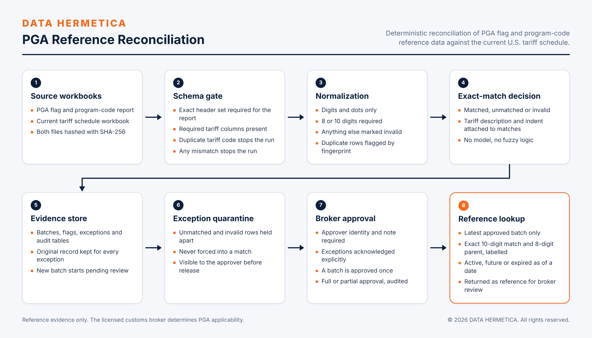

# DATA HERMETICA PGA Reference Reconciliation

Deterministic reconciliation of Partner Government Agency flag and program-code reference data against the current U.S. tariff schedule, with exception quarantine and broker approval.

 

## Overview

The REF-001 report associates PGA flags and program codes with HTS numbers, but it is published separately from the tariff schedule and drifts from it as the schedule is revised. Using it unchecked attaches agency flags to codes that no longer exist. This component matches every report row to the current schedule by exact code, quarantines what does not match, and publishes nothing for lookup until a broker has reviewed and approved the batch. The same inputs always produce the same counts.

Status: deployed in controlled operation.

## Capabilities

- **Schema gate.** The report must carry exactly these 11 headers: PGA Name Code, PGA Flag Code, PGA Flag, PGA Program Code, HTS Number - Full, HTS Long Description, Effective Begin Date, Effective End Date, HTS Update Date, Change Pending Status, Change Pending Status Code. The tariff workbook must carry `HTS Number`, `Indent` and `Description`. A mismatch, or a duplicate code in the tariff workbook, stops the run. Both files are hashed with SHA-256.
- **Normalization.** Digits and dots only; dots removed; 8 or 10 digits required. Anything else is `INVALID`. Duplicate rows are flagged by a 7-field fingerprint.
- **Exact-match decision.** `INVALID`, `MATCHED` (with the tariff description and indent attached) or `UNMATCHED`.
- **Evidence store.** SQLite tables `batches`, `flags`, `exceptions` (with the original record) and `audit`. A new batch starts as `PENDING_REVIEW`.
- **Approval.** Approver identity and a note are required. When exceptions exist, the approver must explicitly accept the matched subset. A batch is approved once, as `APPROVED_FULL` or `APPROVED_PARTIAL`, and the action is audited.
- **Lookup.** Reads the latest approved batch only; returns the exact 10-digit match and its 8-digit parent, each labelled by match basis; marks each flag `ACTIVE`, `FUTURE` or `EXPIRED` for an as-of date; returns `REFERENCE_ONLY_BROKER_APPLICABILITY_REVIEW`.
- **Command line:** `ingest`, `approve`, `lookup`.

## Design principles and controls

| Control | Enforcement |
|---|---|
| Exact matching only | No model and no fuzzy logic participate in the match decision. |
| Quarantine, not repair | Unmatched and invalid rows are stored as exceptions and never forced into a match to raise coverage. |
| Approval before publication | Lookup ignores every batch that is not approved. |
| Labelled match basis | A parent 8-digit match is reported separately from an exact 10-digit match. |
| Reproducibility | Inputs are hashed; repeated ingests of the same inputs yield identical counts. |

## Technology

Python 3.12, SQLite, XLSX workbooks.

## Source availability

Specification of a deployed component. Its source is maintained in the controlled deployment and is not part of this revision of the repository; see the roadmap in the [system README](../../README.md).

## Verification

Read-only query of the evidence store on 2026-11-11:

| Measure | Result |
|---|---|
| Rows processed per run | 81,740 |
| Exact matches | 79,551 (97.32%) |
| Unmatched rows quarantined | 2,189 |
| Invalid rows | 0 |
| Distinct HTS codes in matched rows | 20,774 |
| Agencies / flag codes in matched rows | 12 / 38 |
| Repeated ingests of the same source | 4, identical counts |
| Deterministic false matches in testing | 0 |

## Scope and compliance

- **Deployment model.** Client-controlled infrastructure.
- **Boundaries.** The component shows whether a source report associates a flag or program code with an HTS code. It does not select HTS codes and does not determine PGA applicability.
- **Regulatory position.** Under CBP ruling HQ H350722 (2026-01-16), this system is decision-support software operated by or for a licensed customs broker. The broker makes every classification, approval and filing decision, and the software does not transmit to CBP.

## Roadmap

- Publication of the engine source, synthetic fixtures and tests in this repository.
- Governed triage of the exception queue by cause: range or header rows, obsolete codes, formatting, schedule gaps.

## License

Copyright © 2026 DATA HERMETICA. All rights reserved. Proprietary — see [LICENSE](LICENSE).
