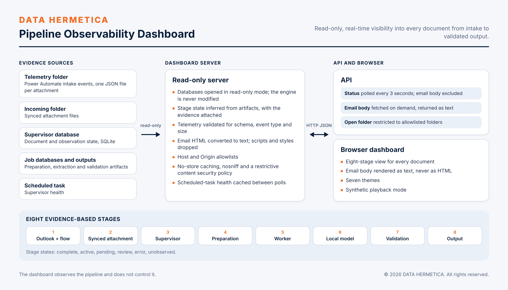

# DATA HERMETICA Pipeline Observability Dashboard

Real-time, read-only visibility into every document from intake through AI extraction to validated output.

 

## Overview

Operators of a document pipeline need to know where each document is and why, without opening logs or databases. The dashboard reconstructs the state of every document from the artifacts the pipeline already produces: intake telemetry, synced files, supervisor and job state, and published outputs. It shows eight stages per document, each with a state and the evidence behind it. It has no write path to the pipeline, so observing cannot change what is observed.

Status: deployed; runs continuously as a Windows scheduled task and is one of the five dashboards of the Control Center.

## Capabilities

- **Eight evidence-based stages:** Outlook + flow, Synced attachment, Supervisor, Preparation, Worker, Local model, Validation, Output. Each stage is complete, active, pending, review, error or unobserved, with the evidence shown.
- **Intake telemetry.** Reads the Power Automate telemetry events defined by the [Document Intake & Extraction Pipeline](../document-intake-extraction-pipeline/docs/power-automate-intake.md). Files over 1 MiB are ignored; schema version and event type are validated.
- **Email body on demand.** The body is excluded from the 3-second status poll, fetched by an explicit request, converted from HTML to text with scripts and styles dropped, and rendered as text.
- **Supervisor health.** Scheduled-task state, cached for 12 seconds.
- **Folder access.** Opening a folder from the dashboard is restricted to an allowlist.
- **Synthetic playback mode** for walkthroughs without live documents, and seven display themes.

## Design principles and controls

| Control | Enforcement |
|---|---|
| Read-only access | SQLite databases are opened by URI with `mode=ro`. The engine and its files are never modified. |
| Stage inference from artifacts | No hook or callback in the engine. A stage with no artifact is reported as unobserved, not assumed. |
| No HTML rendering of email | Server-side conversion to text; the browser assigns the result through `textContent`. |
| Request filtering | Host and Origin allowlists on every request. |
| Response hardening | `Cache-Control: no-store`, `X-Content-Type-Options: nosniff`, and `Content-Security-Policy: default-src 'none'` on API responses. |
| Bounded input | Oversized or malformed telemetry files are skipped. |

## Technology

Python 3.12 standard library (HTTP server, `sqlite3`, `html.parser`), a single-page HTML and JavaScript client, Windows Task Scheduler.

## Interfaces

| Interface | Direction | Purpose |
|---|---|---|
| Status API | browser to server, polled every 3 seconds | Document list with stage states and evidence |
| `POST /api/email` | browser to server, on demand | Email subject and body as text for one document |
| `POST /api/open-folder` | browser to server | Open an allowlisted folder on the host |
| Telemetry, intake and result folders; supervisor and job databases | server reads | Evidence sources |

| Configuration | Purpose |
|---|---|
| `PIPELINE_ENGINE_ROOT` | Engine root whose state and work folders are observed |
| `PIPELINE_DASHBOARD_REMOTE_ORIGIN` | Optional additional origin admitted by the Host and Origin allowlists |

## Source availability

Specification of a deployed component. Its source is maintained in the controlled deployment and is not part of this revision of the repository; see the roadmap in the [system README](../../README.md).

## Verification

| Date | Evidence | Result |
|---|---|---|
| 2026-11-11 | Live mode in controlled operation | 14 documents: 13 completed, 1 in review; telemetry present on the 3 newest documents with all eight stages complete |
| 2026-11-10 | Unit tests on synthetic fixtures, previous build | 11 of 11 passed |

## Scope and compliance

The dashboard runs on client-controlled infrastructure and listens on loopback, with remote access only through a private network. It observes and does not control: it cannot start, stop, retry or alter processing.

## Roadmap

- Publication of the dashboard source and its unit tests in this repository.
- Stage coverage for additional document types as the pipeline adds them.

## License

Copyright © 2026 DATA HERMETICA. All rights reserved. Proprietary — see [LICENSE](LICENSE).
