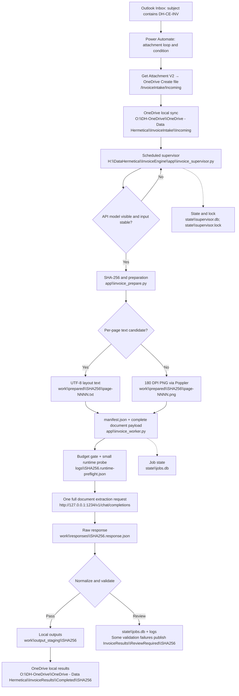

## 3. Complete pipeline and physical paths

Paths below `app`, `work`, `logs`, and `state` in the diagram are relative to `H:\DataHermetica\InvoiceEngine`. SHA256 is a runtime content hash, not a literal folder name to create. The active invoice model receives page text extracted by Poppler or rendered page images directly; there is no OCR stage. The model performs the variable-layout invoice reading.

“One extraction request” means one complete-document extraction call. A separate tiny JSON readiness inference also runs beforehand. Do not describe this as exactly one HTTP request total.

| Directory/file | Role |
|---|---|
| `app\invoice_prepare.py` | Stable source hash; per-page text/image preparation |
| `app\invoice_worker.py` | Assemble payload, preflight, extract, normalize, validate, publish |
| `app\invoice_upgrade_output.py` | Migrate previous output without inference |
| `app\invoice_supervisor.py` | Poll Incoming and orchestrate preparation/worker |
| `config\engine_config.json` | Model, API, budget, prompt/schema filenames |
| `config\invoice_system_prompt_baseline.txt` | Approved extraction definitions |
| `config\invoice_extraction_schema.json` | JSON output contract |
| `config\invoice_supervisor_config.json` | Polling, stability, timeouts, logs |
| `work\prepared\<hash>\manifest.json` | Page routing and source identity |
| `work\requests\<hash>.request.json` | Request audit; image bytes omitted, text retained |
| `work\responses\<hash>.response.json` | Original API response |
| `work\output_staging\<hash>` | extraction.json, extraction.md, invoice CSV, validation.json, unit-price-normalization.json |
| `state\jobs.db` | Worker SQLite job state |
| `state\supervisor.db` | Supervisor observations and document state; WAL mode |
| `state\supervisor.lock` | OS-held single-process lock |
| `logs\invoice-supervisor.log` | Rotating supervisor log |
| `logs\<hash>.runtime-preflight.json` | Successful runtime probe response |
| `logs\<hash>.configuration-error.txt` | Context or runtime configuration rejection |
| `logs\<hash>.failure.log` | Worker exception traceback |
| `backup\supervisor_before_install_<timestamp>` | Installer backup of replaced supervisor/config |
| `quarantine` | Earlier reserved directory; no automatic quarantine movement demonstrated |
| `tests` | Unit-price parser tests from v1.2 package |

Do not use the old top-level `prepared` directory. Current prepared files belong under `work\prepared`.

