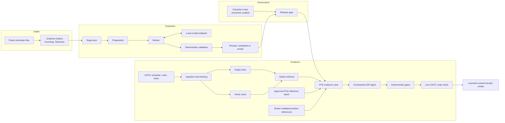
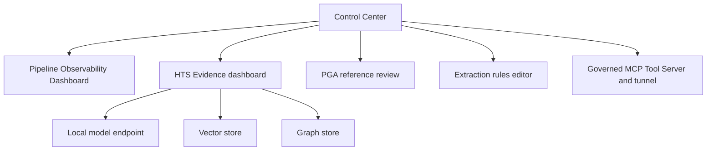

# System architecture

## Data plane

## Control plane

Every dashboard is a separate loopback HTTP service started at logon by a scheduled task. Task policy ignores a second start, and a listener check confirms one listener per service.

## Component interfaces

| From | To | Interface | Content |
|---|---|---|---|
| Power Automate flow | Extraction pipeline | Synced folder | Attachment files |
| Power Automate flow | Observability dashboard | Synced folder | Telemetry events, `schema_version` 1 |
| Extraction pipeline | Observability dashboard | Files and SQLite, read-only | Manifests, job state, results |
| Extraction rules governance | Extraction | Generated JSON Schema | Fields, types and constraints |
| Extraction rules governance | Evidence engine | Release gate | Approved, forwardable facts only |
| PGA reference reconciliation | Evidence engine | Lookup on the latest approved batch | Flags and program codes, reference only |
| Evidence engine | Broker | Case record and review export | Suggestion, citations, eliminated alternatives, questions |
| AI clients | Workstation and analysis tools | Model Context Protocol | Tool calls under policy |

## Trust boundaries

| Boundary | Control |
|---|---|
| External email to intake | Subject-code filter and attachment condition |
| Document content to model | Content treated as data; strict output schema; deterministic validation |
| Extracted data to classification | Active configuration, per-field forwarding flags, recorded broker approval |
| Reference report to lookup | Exact match, exception quarantine, batch approval |
| Model proposal to broker | Closed evidence set, closed candidate set, live code verification, mandatory review routing |
| AI client to workstation | Server-side policy, allowlists, limits, audit |

## Evidence classes

| Class | Examples | Use |
|---|---|---|
| Legal authority | Tariff text, section and chapter notes, General Rules of Interpretation, verified CBP rulings | May support a classification |
| Reference evidence | Broker product precedents, PGA flag reports, printed foreign commodity codes, trade statistics | Context for the broker; never proof |
| Methodology | Internal classification workflow guidance | Process only; labelled as not legal authority |
| Model output | Extractions, query plans, proposals | Untrusted until it passes deterministic gates |

## Runtime

A single Windows workstation hosts the model server, the two stores in containers, the services and their scheduled tasks. Credentials for the tunnel and for the trade-statistics API are stored with DPAPI, bound to the Windows account. Runtime state, logs, databases and document data are kept outside this repository.
